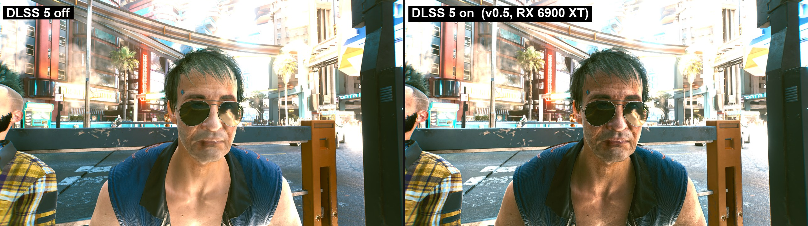
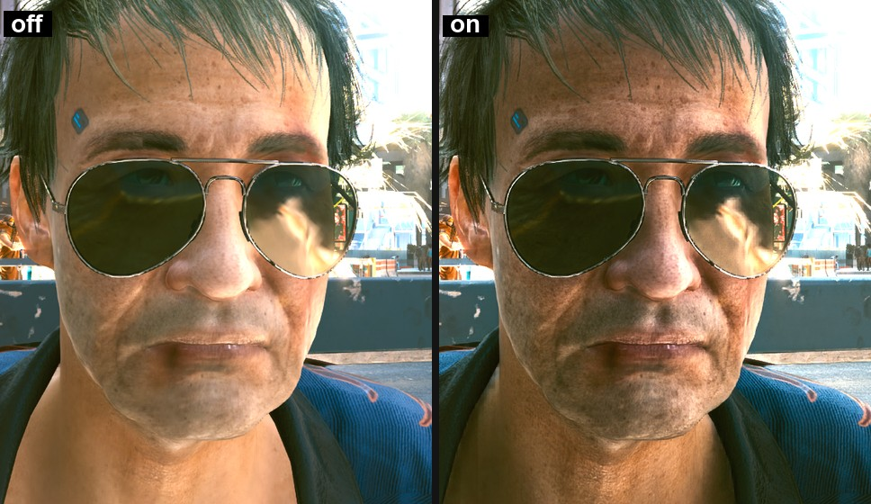

# DLSS 5 Neural Rendering on AMD RX 6000 cards (experimental)

**Deutsch:** [README_DE.md](README_DE.md) · **Download:** [latest release (v0.5)](../../releases/latest) · **Changes:** [CHANGELOG.md](CHANGELOG.md)



<p align="center"></p>

<p align="center"><i>Cyberpunk 2077, 1440p, FSR 4.1 Quality, RX 6900 XT, v0.5 default settings (Hybrid_1440). Left: DLSS 5 off. Right: on. ~35 FPS.</i></p>

## What is this?

NVIDIA's **DLSS Neural Rendering** ("DLSS 5") is a neural network that re-renders every frame: more realistic light,
skin, materials and contrast. NVIDIA only ships it for GeForce RTX cards with Tensor Cores.

This project runs **NVIDIA's own DLSS 5 network** (from NVIDIA's `nvngx_dlssnr.dll`, which you supply) on **AMD Radeon
RX 6000 (RDNA2)** cards, which have no AI hardware at all. It is a full re-implementation of the network's inference in
**our own HIP compute kernels**, written for RDNA2, plus a DirectX bridge that plugs it into games through OptiScaler.

**No HIP SDK or ROCm install needed.** The HIP runtime the port uses (`amdhip64_6.dll`) ships with the normal AMD
Adrenalin driver. You only need a recent driver, the ZIP and NVIDIA's `nvngx_dlssnr.dll`.

> **Experimental.** It can crash, look wrong, or cost a lot of FPS. Do not use it in online games with anti-cheat.

### Why v0.5 is different

- **The real look, finally.** The network has full-resolution detail blocks (skin pores, cloth, fine contrast) and a
  half-resolution main network. Earlier versions (ours and other ports) ran the whole network at 540p/720p, i.e. the
  detail at a quarter of NVIDIA's pixels. **v0.5 runs the detail blocks at your output resolution** ("hybrid mode").
  Measured in Cyberpunk at 1440p: **~3x** the on/off difference of our old 720p default, ~78 % of all pixels changed.
- **Fast enough to play:** ~35 FPS at 1440p with the full look, ~45 FPS with `Hybrid_1440_Fast` (RX 6900 XT, no frame generation).
- **No ghosting on upscaled games:** motion vectors from the upscaler (render resolution) are now scaled correctly.
- **All kernels are our own.** No NVIDIA code or data in the package; the weights are read from your copy of NVIDIA's DLL at load time.

## How it works (technical)

```
 game frame ──► OptiScaler ──► nvngx.dll_dlssnr.dll (D3D12/D3D11 bridge) ──► nr_runtime.dll (HIP, RDNA2) ──► back to the game
 (after FSR/DLSS/XeSS)          colour, depth, motion       import / export shaders,    the DLSS 5 network,
                                vectors, NR sliders         history, nr_split warp      ~80 GPU dispatches
```

**The network** (NVIDIA's 310.9.16 "small" model, also the older 310.8 model):
full-resolution **pre block** (features + a Swin block) → U-Net encoder with **Swin window-attention** levels
(C = 32/64/128/256) → a **ViT** bottleneck (8 blocks, global attention) and C=512 conv/attention blocks → decoder → full-resolution **post block**
that produces the edit. Weights and activations are **FP8 (e4m3)**; NVIDIA runs this on FP8 Tensor Cores.

**On RDNA2 (no Tensor Cores, no FP8):**
- Every GEMM runs on `v_dot2_f32_f16` (2 MACs/lane/clock) or `v_dot4_i32_i8` (int8 paths), with exact FP8 rounding emulated
  in software (`q8`/e4m3 packing in 1-2 instructions). The network output matches the PyTorch reference implementation at
  **37-43 dB** with edit correlation **0.96-0.99**.
- **Lane = token** Swin kernels (c32, c64, pre/post): one 8x8 window per 64-thread workgroup, weights streamed through
  SGPRs from a load-time shadow, attention exchanged through 12 KB of LDS (5 workgroups per CU). The new c64 kernel is
  ~25 % faster than the previous design and byte-identical.
- **ViT / C512 GEMMs:** 8x4 register tiles, 128 threads, LDS operand prefetch, swizzled LDS layout without bank conflicts.
- **Hybrid resolution:** pre/post blocks at output size, the U-Net/ViT 1.5x smaller, bridged by a resample kernel.
- **Temporal amortisation** (`nr_split`): the network runs over 2-3 frames; every displayed frame warps the newest result
  with the game's motion vectors, rejects disoccluded areas by colour/depth gates, fills them from the surroundings and
  fades new results in. The ViT reuse switches itself off on fast camera motion.
- **D3D12 ↔ HIP** share memory and fences; the game never waits longer than the network's share of the frame.

## Performance (RX 6900 XT, new model 310.9.16)

| Preset | Network | Per displayed frame | Cyberpunk 1440p | Look |
|---|---|---|---|---|
| **Hybrid_1440** (default) | 28-32 ms | ~14-16 ms (`nr_split=2`) | **~35 FPS** | near-full DLSS 5 |
| **Hybrid_1440_Fast** | 28-32 ms | ~10 ms (`nr_split=3`) | **~45 FPS** | near-full; moving people shimmer more |
| **Hybrid_1080** | 17-19 ms | ~9 ms | – | near-full at 1080p |
| **Full_1440** | 48 ms | ~24 ms | ~25 FPS | NVIDIA's full layout |
| `classic/` 720p / 540p | 14 / 9 ms | 3-7 ms | – | only a fraction of the effect |

Measured on the same RX 6900 XT at 720p, same new model, same benchmark harness: **this port 10.8 ms vs 19.4 ms** for another
public vendor-neutral port of the network. With frame generation (FSR-FG / XeFG) the displayed frame rate roughly doubles.

**New in v0.5** (full list in the [release notes](../../releases/tag/v0.5)): hybrid mode at output resolution, ghosting fix for
upscaled motion vectors, clean `nr_split` (fade-in, halo fix, motion gate), crash fix when NR is re-created, faster
c64/ViT kernels, new presets `Hybrid_1440`, `Hybrid_1440_Fast`, `Hybrid_1080`, `Hybrid_4K`, `Full_1440`, `Full_1080`.

<details><summary>Older versions (v0.3 - v0.4)</summary>

**New in v0.4:**
- **NVIDIA's new DLSS 5 model** (nvngx_dlssnr.dll 310.9.16) is used automatically: about **2x lighter**, ~10 ms per network run at 960x540 on an RX 6900 XT (v0.3: 24 ms). The old 310.8 DLL still works with the old model.
- **Cyberpunk 2077, 1440p, FSR Quality, no frame generation, RX 6900 XT:** 54.7 fps on High, 85.3 fps on Low (v0.3: 43.8 fps on High; danielblnc v0.6.0 on the same card: 21.7 fps).
- **Image much closer to NVIDIA's** (+6-8 dB vs the reference; 4 network bugs fixed), NVIDIA's default look, and the **OptiScaler NR sliders now work** (intensity, style, tone, structure, skin).
- **Much less flicker** (`edit_temporal`, flicker -90 %), network split over 3 frames for even, higher fps.
- **Looks to choose from** (`presets\`): Standard, Strong, Cinematic, HighQuality_720p, HiRes_1080p, Native_1440p, Performance, Community.
- **Network resolutions up to 1080p / 1440p** for more fine detail (costs fps).
- All kernels are our own; no NVIDIA data in the package. Full list: [CHANGELOG.md](CHANGELOG.md).

**New in v0.3.1:** uses the right GPU (never the iGPU), VRAM leak fix, HDR auto-exposure, clean NR-off with an unknown
`nvngx_dlssnr.dll`, all kernels our own, a bit faster and less VRAM.

**New in v0.3:** up to 60 FPS without frame generation on an RX 6900 XT, even frame pacing, no more stutter
in fast games, HDR fix (no more white characters), clean 2 passes, safe setup with backup and uninstaller.
See [CHANGELOG.md](CHANGELOG.md).

</details>

## Does my PC work?

You need **all** of these:

| | |
|---|---|
| ✅ Graphics card | AMD **RX 6000 series**, see the table below. RX 7000/9000, NVIDIA and Intel do **not** work. |
| ✅ Windows | Windows 10 or 11, 64-bit |
| ✅ AMD driver | A recent AMD Adrenalin driver ([download](https://www.amd.com/en/support/download/drivers.html)). **Nothing else:** no HIP SDK, no ROCm. |
| ✅ Game | A 64-bit DirectX 11 or DirectX 12 game where you can choose **DLSS, FSR or XeSS** in the graphics settings |
| ✅ NVIDIA model file | `nvngx_dlssnr.dll`. **Not included**, you have to get it yourself (see step 2) |

| Graphics card | Status | Network per frame, Hybrid_1440 (v0.5) |
|---|---|---|
| RX 6900 XT / 6950 XT | ✅ tested | ~14-16 ms (measured) |
| RX 6800 / 6800 XT | ✅ works (user reports) | ~16-21 ms (estimate) |
| RX 6700 / 6700 XT / 6750 XT | ✅ works (user reports) | ~30 ms (estimate; use Hybrid_1080) |
| RX 6600 / 6600 XT / 6650 XT | ✅ works (user reports) | ~45 ms (estimate; use Hybrid_1080 or classic) |
| RX 6500 XT / 6400 | 🧪 should work, slow | use `classic/` presets |

**Runs on the whole RX 6000 (RDNA2) family.** First user reports average **about 55 FPS** in game. More reports
are welcome in [Issues](../../issues) (attach your `dlssnr_nr.log`, it lists your GPU and timings).

Not sure which graphics card you have? Press `Ctrl + Shift + Esc`, click **Performance**, click **GPU**.
The name is in the top right corner.

## Installation

### Step 0: Back up your game folder

Copy your whole game folder somewhere safe (for example to your desktop). If something goes wrong, copy it back.

### Step 1: Download

Go to [**Releases**](../../releases/latest) and download the ZIP (`DLSS5-RDNA2-Experimental-...zip`). Every RX 6000 card uses the same (latest) ZIP.

### Step 2: Get the NVIDIA model file

This mod does **not** contain any NVIDIA files. You need the file **`nvngx_dlssnr.dll`** (about 160 MB).
How to get it is explained in janblade's guide:
[Choose the correct runtime](https://github.com/janblade/OptiScaler-DLSSNR-PreSR-Multipass/blob/main/INSTALL-DLSSNR.md#choose-the-correct-runtime).

### Step 3: Find your game folder

This is the folder with the game's **real 64-bit** `.exe` file, the one that actually starts the game.
It is **not** always the main install folder: many games have a small launcher `.exe` at the top and the
real game `.exe` further down.

- **Steam:** right-click the game → **Manage** → **Browse local files**
- **Epic / GOG / others:** right-click the game → open install folder

Look for these subfolders first. If one of them has the game `.exe` inside, use **that** folder:

| Folder pattern | Example |
|---|---|
| main folder (no launcher) | `...\Fallout 4\` (has `Fallout4.exe`) |
| `bin\` or `bin\x64\` | `...\Cyberpunk 2077\bin\x64\` (has `Cyberpunk2077.exe`) |
| `x64\` | `...\GameName\x64\` |
| `<Name>\Binaries\Win64\` (Unreal games) | `...\Jedi Survivor\SwGame\Binaries\Win64\` |

Tip: start the game, open Task Manager → **Details**, right-click the game process → **Open file location**.
That opens exactly the right folder. `setup_windows.bat` warns you if the folder has no 64-bit `.exe`.

### Step 4: Copy the files

1. Open the ZIP from step 1.
2. Copy **everything** in it into the game folder. Click **Replace** if Windows asks.
3. Copy `nvngx_dlssnr.dll` from step 2 into the same game folder.

### Step 5: Run the setup

In the game folder, double-click **`setup_windows.bat`**. A black window opens and asks some questions:

> ⚠️ **Do you use ReShade or ENB?** Then **never** overwrite. If the script asks "overwrite?", answer `2` and pick `2` (`winmm.dll`). Overwriting deletes the ReShade/ENB file and the game may stop starting.

| Question | Type |
|---|---|
| "Do you want to delete these files?" (only if an old OptiScaler is there) | `1` + Enter |
| "Choose a filename for OptiScaler" | just Enter (= `dxgi.dll`) |
| "dxgi.dll already exists ... overwrite?" (you use ReShade or another mod) | `2` + Enter, then pick `2` (`winmm.dll`) |
| "Are you using an Nvidia GPU or AMD/Intel GPU?" | `1` + Enter (AMD) |

When the window says it is done, close it.

### Step 6: Start the game

1. In the game's graphics settings, turn on **DLSS**, **FSR** or **XeSS** (whatever the game offers).
2. In the game, press the **`Insert`** key. The OptiScaler menu opens.
3. Open **DLSS Neural Rendering** and make sure **Enable Neural Rendering** is ticked.
4. Press `Insert` again to close the menu.


The first start takes a few seconds longer. That is normal.

**DirectX 11 games** (for example Fallout 4): in the menu at the top, under **Upscalers**, pick an
upscaler that says **w/Dx12** (for example `FSR 2.2.1 w/Dx12`) and restart the game.

## Choosing a look

The folder `presets` has complete settings files. To switch, copy one over `nr_port.ini` in the game folder and restart the game.
The package `nr_port.ini` is **Hybrid_1440** with `model_res=auto` (it follows your output size).

| Preset | Look | Network time per frame, RX 6900 XT | When to use it |
|---|---|---|---|
| **Hybrid_1440** (default) | Near-full DLSS 5 look: detail at 1440p, main network 1.5x smaller, split over 2 frames | ~15 ms (network 29.7 ms) | 1440p screens. Cyberpunk: ~35 FPS |
| **Hybrid_1440_Fast** | Same, split over 3 frames | ~10 ms | More FPS (~45 FPS in Cyberpunk), people in motion can shimmer more |
| **Hybrid_1080** | Hybrid at 1080p | ~9 ms (network 18.2 ms) | 1080p screens, or more FPS |
| **Hybrid_4K** | Hybrid at 2160p, split over 3 | heavy | 4K screens |
| **Full_1440** / **Full_1080** | Whole network at full size (NVIDIA's layout): most detail | ~24 / ~13 ms (network 48 / 26 ms) | Screenshots, best image |
| `classic/*` | The old 360p-720p presets | 3-8 ms | Weak GPUs; **only a fraction of the effect** |

All presets use the new model (nvngx_dlssnr.dll 310.9.16). With the old 310.8 DLL the classic plans in `nr_data_h15` are used (no hybrid).
Combine with **FSR 4.1** (official on RX 6000 since driver 26.10.1) at Quality or Balanced: the network works on the upscaled picture, so a better upscaler means a better DLSS 5 result.

The OptiScaler NR sliders (intensity, style, local tone, local structure, skin) now change the image live. A key in `nr_port.ini` (e.g. `local_tone=0.5`) overrides the slider.

## Which nvngx_dlssnr.dll?

Works with nvngx_dlssnr.dll 310.8 (old model) and 310.9.16 (new, ~2x lighter model, auto-selected; model=large forces the old one). With any other model, NR switches itself off — wait for a port update.

The game keeps running with its normal image. `dlssnr_nr.log` then says "has a different model than this port supports (310.8 / 310.9.16)".

## Best image: NR + FSR 4.1 on RX 6000

The network works on the upscaled picture, so a better upscaler means a better DLSS 5 result. Since AMD driver
**26.10.1** FSR 4.1 is official on RX 6000. In OptiScaler (`OptiScaler.ini`) set `UpscalerIndex = 0` (FSR 4) and
`Fsr4Preset = 1` (Quality), then pick FSR Quality or Balanced in the game.

## Known issues (v0.5)

- Minimal white noise and slight ghosting on very fast motion remain with `nr_split`. For the cleanest picture use `nr_split=0` (slowest).
- Strong settings (intensity 2, tone 2, Cinematic) make the effect much stronger but also increase flicker; that is NVIDIA's network itself.
- With `Hybrid_1440_Fast` (`nr_split=3`) moving people can shimmer more.
- Games without motion vectors (no upscaler selected) trail with `nr_split`; select FSR, DLSS or XeSS in the game.

## It does not work. What now?

Open the file **`dlssnr_nr.log`** in the game folder with Notepad and look at the last lines:

| What the log says | What to do |
|---|---|
| `runtime ready` | It works. Check that Neural Rendering is enabled in the `Insert` menu. |
| `nvngx_dlssnr.dll missing or wrong version` | `nvngx_dlssnr.dll` is missing in the game folder, or it is a version with different weights. Get it again (step 2). |
| `not an RDNA2 GPU` | Your graphics card is not supported (see "Does my PC work?"). |
| `hipModuleLoad ...` | Your card could not load the program. Please report it in [Issues](../../issues) with the log. |
| Game says a DirectX / d3d11 / dxgi file is missing | In Steam: right-click the game → Properties → Installed Files → **Verify integrity of game files**. If you use ReShade or ENB, reinstall it. |
| No `dlssnr_nr.log` file at all | The mod did not load. Run `setup_windows.bat` again and check that you selected an upscaler in the game. |

## Uninstall

In the game folder, double-click **`Uninstall_DLSS5.bat`** and press `1`. It removes OptiScaler and our files
(`nr_data`, `nr_runtime.dll`, `nr_port.ini`, `nvngx.dll_dlssnr.dll`, logs) and puts back every file that
`setup_windows.bat` replaced or deleted (those are saved in `DLSS5_backup\`). Your `nvngx_dlssnr.dll` is kept.

## Is this faster or slower?

Slower: the network costs GPU time because RX 6000 cards have no AI units. With v0.5 (Hybrid_1440, split over 2 frames) an RX 6900 XT reaches about **35 FPS in Cyberpunk 2077 at 1440p with FSR Quality, with the full DLSS 5 look**. More FPS: `Hybrid_1440_Fast` or `Hybrid_1080`.

## Who made what?

| Part | By |
|---|---|
| The AI model (DLSS Neural Rendering) | **NVIDIA**. It lives in `nvngx_dlssnr.dll`, which you get yourself. |
| Getting the model to run on AMD RX 6000 | **This project** (`nr_runtime.dll`, `nvngx.dll_dlssnr.dll`, `nr_data`) |
| Getting it into games (menu, settings) | [**janblade's OptiScaler-DLSSNR**](https://github.com/janblade/OptiScaler-DLSSNR-PreSR-Multipass) and the [OptiScaler](https://github.com/optiscaler/OptiScaler) team, see `docs/CREDITS.md` in the release |

Started in danielblnc's Discord; early versions were based on his gfx1100 kernels — all kernels are now our own.

This project contains no NVIDIA files or weights. DLSS and NVIDIA are trademarks of NVIDIA
Corporation. This project is not affiliated with or endorsed by NVIDIA or AMD.

## For developers

The source code of `nr_runtime.dll` and `nvngx.dll_dlssnr.dll` is in [`src/`](src). Build with
`src\build.bat` (needs AMD ROCm 6.4 for Windows and Visual Studio 2022 Build Tools).

## License

[GPL-3.0](LICENSE)
